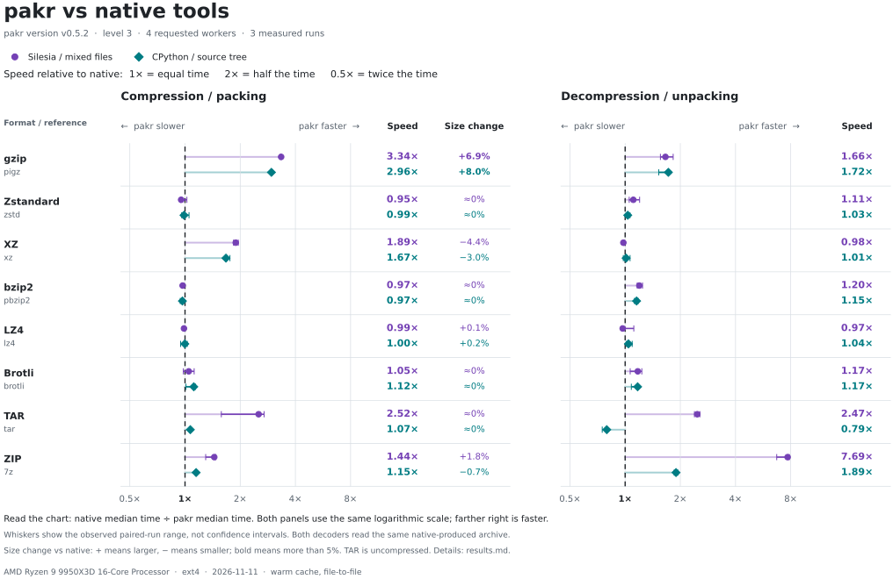

<picture>
	<source media="(prefers-color-scheme: dark)" srcset=".github/banner.svg">
	<source media="(prefers-color-scheme: light)" srcset=".github/banner-light.svg">
	
</picture>

A single-binary CLI for packing and unpacking archives, with native compression, consistent flags and concise progress output.

[Installation](#installation) | [Quick start](#quick-start) | [Usage](#usage) | [Formats](#formats) | [Performance](#performance) | [Filesystem behavior](#filesystem-behavior)

## Installation

Download binaries for **Linux, Windows and macOS**, in **amd64 and arm64**, from [GitHub Releases](https://github.com/coalaura/pakr/releases). No separate compression tools are required.

On Linux and macOS, install the latest release with:

```sh
curl -fsSL https://src.ws2.sh/pakr/install.sh | sh
```

The installer detects your platform, verifies the release's SHA-256 checksum and installs to `/usr/local/bin/pakr`, using `sudo` when needed. It requires `curl` and either `sha256sum` or `shasum`.

For manual installation, choose `pakr-<os>-<arch>` (`darwin` for macOS), make it executable and place it on your `PATH` as `pakr`. On Windows, download `pakr-windows-<arch>.exe` and rename it to `pakr.exe`. Releases include a `SHA256SUMS` file.

## Quick start

```sh
# Pack files and directories.
pakr pack documents photos -o backup.tar.zst

# Choose a format and compression preset.
pakr pack project -o project.tar.gz -p fast

# Compress a single file.
pakr pack report.csv -o report.csv.gz

# Extract an archive.
pakr unpack backup.tar.zst -o restored

# Pipe an archive between commands.
pakr pack project -f tar.zst -o - | pakr unpack - -f tar.zst -o restored
```

## Usage

### Packing

`pakr pack <paths...>` infers the format from the output filename or defaults to `tar.zst`. Without an output path, it writes `archive.<format>`. Directories retain their basename; passing `.` archives the current directory's contents.

Raw compression formats such as `gz` accept exactly one regular file. Use a container such as `tar.gz`, `zip` or `7z` for multiple files or directories. Use `-o -` to write archive bytes to stdout.

### Unpacking

`pakr unpack <archive | ->` extracts into the current directory unless `-o` specifies a destination. Formats are detected from the filename extension or recognizable signatures. Use `-f` when detection is unavailable, including compressed tar from stdin and extensionless Brotli, LHA/LZH or legacy LZMA input.

Raw streams extract to the input filename with its final extension removed, or to `stdin` for piped input. Formats that require seeking use a temporary file when reading from stdin.

### Options

Flags may follow input paths.

| Flag | Description |
| --- | --- |
| `-o`, `--output` | Output archive when packing; destination directory when unpacking |
| `-f`, `--format` | Explicit format or alias |
| `-t`, `--threads` | Worker budget: `auto` (default), `all` or 1-256 |
| `--memory` | Allocation budget for supported codecs: `auto` (default) or a size such as `2GiB` |
| `-q`, `--quiet` | Hide status, progress and errors; failures still return a nonzero exit code |
| `--formats` | Show supported formats, speeds and size savings, then exit |
| `-v`, `--version` | Print the version |

Packing also accepts:

| Flag | Description |
| --- | --- |
| `-l`, `--level` | Compression effort: 1-9, default 3 |
| `-p`, `--preset` | `fast` (1), `balanced` (3) or `best` (9); exclusive with `--level` |
| `--max` | All logical CPUs within codec budgets, level 9 and XZ's extreme preset |
| `--seekable` | Seekable Zstandard output for `zst` and `tar.zst`, readable by ordinary Zstandard tools |

Explicit `--threads`, `--level` or `--preset` settings override their respective `--max` defaults regardless of argument order. Explicit `--level 9` or `--preset best` also overrides XZ's extreme setting.

### Extraction limits

| Flag | Default | Limits |
| --- | --- | --- |
| `--max-output` | `16TiB` | Total extracted payload |
| `--max-file-size` | `1TiB` | Payload per file |
| `--max-entries` | `10000000` | Entries, including directories and links |

Set a limit to `0` to disable it. Byte limits accept integer bytes or `KiB`, `MiB`, `GiB` and `TiB` suffixes.

```sh
pakr unpack backup.zip -o restored --max-output 32TiB --max-file-size 2TiB
```

Exceeding a limit cancels extraction and removes incomplete files; already completed entries may remain. These limits measure extracted payload, not process memory. Temporary-file spooling for stdin has a separate input-size bound, which remains active when extraction limits are disabled.

### Status output

Status goes to stderr, keeping stdout clean for archive data. Terminals show live progress, followed by a summary:

```text
:: packed 1248 entries | 842.0 mib -> 219.0 mib (26.0%) | 3.2s | backup.tar.zst
:: unpacked 1248 entries | 842.0 mib | 1.8s | restored
```

Entries include directories and links; data sizes count regular file contents. The percentage is archive size relative to original data size. Use `--quiet` to suppress all status output, including errors.

## Formats

| Type | Pack and unpack | Unpack only |
| --- | --- | --- |
| Archives | `tar`, `zip`, `7z` | `zipx`, `rar` |
| Compression streams | `gz`, `zst`, `bz2`, `bz3`, `bsc`, `knz`, `xz`, `lz`, `lz4`, `br`, `Z`, `lzma` | - |
| Images and packages | `iso`, `cpio`, `ar`, `wim`, `esd` | `cab`, `deb`, `lha`, `lzh`, `rpm` |

### Compressed tar and aliases

Combine tar with a compression format to bundle files and directories:

| Format | Short aliases |
| --- | --- |
| `tar.gz` | `tgz` |
| `tar.zst` | `tzst` |
| `tar.bz2` | `tbz`, `tbz2` |
| `tar.bz3` | `tbz3` |
| `tar.bsc` | `tbsc` |
| `tar.knz` | `tknz` |
| `tar.xz` | `txz` |
| `tar.lz` | `tlz` |
| `tar.lz4` | - |
| `tar.br` | - |

Raw format aliases include `gzip`, `zstd`, `bzip2`, `bzip3`, `lzip` and `brotli`. The `lzma2` alias selects an XZ container; `lzma` selects legacy LZMA-Alone. Lzip (`lz`) is a separate format. AR also accepts `a`.

Compressed CPIO supports `cpio.gz`, `cpio.bz2`, `cpio.xz` and `cpio.zst`. `tar.Z` and `tar.lzma` are not supported.

### Format notes

- **ZIP / ZIPX:** extraction supports Store, Deflate, BZIP2, LZMA, ZSTD, XZ and PPMd. Unsupported methods and encrypted entries are rejected.
- **RAR:** extracts supported single-volume RAR4/RAR5 archives. Encrypted, multipart and unsupported solid archives are rejected.
- **WIM / ESD:** packing creates one image. Use `--image N` when unpacking a multi-image archive, for example `pakr unpack backup.esd -o restored --image 2`. Extraction restores file contents, not a deployable Windows installation; unsupported entries such as junctions and alternate streams cause extraction to fail. Staging requires extra disk space, and destination paths must not already exist, including directories.
- **ISO:** supports ISO9660 with Rock Ridge and Joliet. UDF, boot-image creation and mounting are not supported.
- **DEB / RPM:** extracts package contents without installing them. DEB's inner archives are left packed; RPM extracts its CPIO payload.
- **Kanzi:** reads and writes version-7 streams. Raw Kanzi also supports stdin packing (`pakr pack - -f knz -o -`) and stdout unpacking (`pakr unpack input.knz -o -`).

## Performance

The charts compare pakr with native tools on mixed files and a source tree, using level 3, four requested workers and three measured runs. Speed is relative to the native tool: **1x is equal, 2x takes half the time**. Results depend on the format, input and hardware; compressed-size differences are shown alongside packing speed.

<picture>
	<source media="(prefers-color-scheme: dark)" srcset=".github/performance-dark.svg">
	
</picture>

### Choosing settings

- Start with the default `tar.zst` format and `balanced` preset for general use. Choose `fast` for lower compression effort or `best` for higher effort.
- Levels describe effort, not equivalent settings across codecs. Higher levels can require substantially more memory.
- `--threads auto` follows Go's concurrency setting (`GOMAXPROCS`); `--threads all` uses all visible logical CPUs. Both are capped at 256. The worker budget is an upper bound, and some codecs remain single-threaded.
- Seekable Zstandard enables parallel decoding of compatible files, but independent frames can reduce compression ratio. It is opt-in with `--seekable`.

### Memory

`--memory` applies to BSC, BZIP3, Kanzi, Lzip, WIM and ESD for both packing and unpacking, and to XZ and LZMA-Alone packing. Other codecs use fixed budgets.

The default `auto` budget uses one quarter of the detected available memory, capped at 8 GiB. Set an explicit budget with a value such as `--memory 2GiB`. Depending on the codec, pakr reduces workers or rejects settings that cannot fit; it does not silently lower compression effort. These are allocation budgets, not whole-process memory limits.

## Filesystem behavior

- **No overwrites:** existing output archives and extracted files are never overwritten. Packing requires a destination filesystem that supports hard links.
- **Contained extraction:** paths and link targets that escape the destination are rejected. Failed extraction removes incomplete files; previously completed entries may remain.
- **File types:** regular files, directories and internal relative symlinks are supported where the format allows them. Hardlink support depends on the format. Symlinks on Windows require OS permission.
- **Metadata:** permission bits and modification times are preserved where supported. Ownership, ACLs and extended attributes are not restored.
- **Limitations:** special files, encrypted archives and sparse-file optimization are not supported. Keep input files stable while packing.

## Third-party software

See [THIRD_PARTY.md](THIRD_PARTY.md) for dependency attribution and licenses. BZIP3 is statically linked under LGPLv3 and wimlib under LGPL-2.1-or-later; the [licensing and relinking section](THIRD_PARTY.md#bzip3-and-wimlib-licensing-and-relinking) explains permissions and rebuilding with modified libraries. Binary releases include a matching source bundle with application and dependency sources, licenses and rebuild materials.
